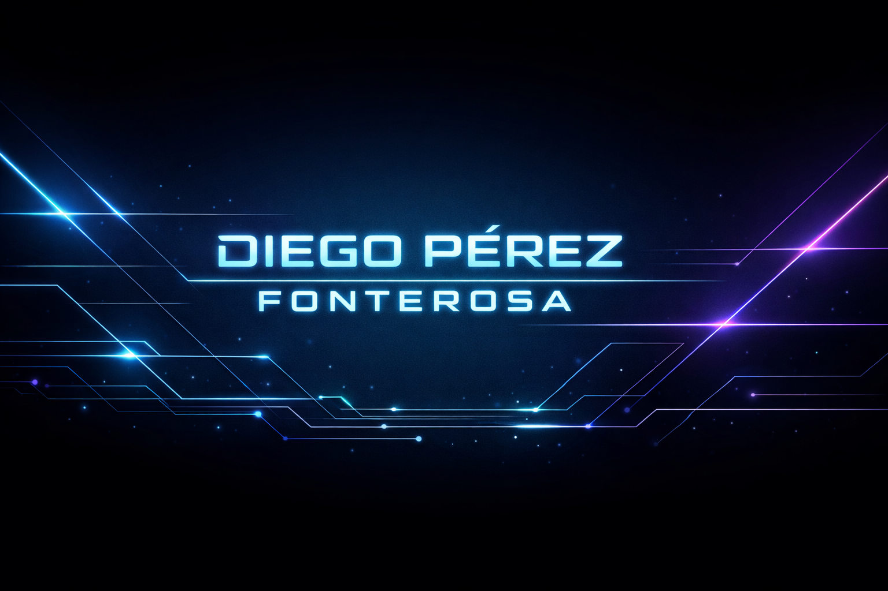
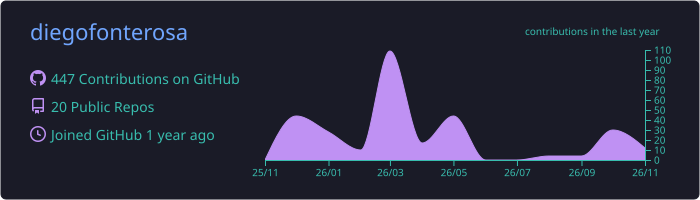
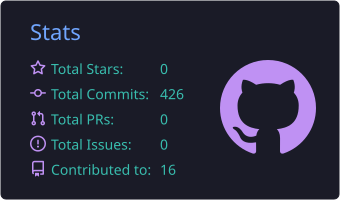
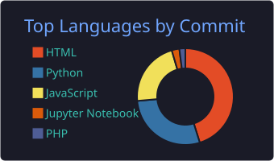

  

<h1 align="center">Hola, soy Diego Pérez Fonterosa</h1>
<h3 align="center">Sistemas y ciberseguridad · SOC · NOC · Soporte IT</h3>

  
  
  

## Sobre mí

Durante **16 años** trabajé como operador técnico en una **central receptora de alarmas**: monitorización 24/7, gestión de incidencias en tiempo real y soporte técnico. Ahora llevo esa experiencia a la seguridad informática.

- Terminando el **CFGS de ASIR** (nota media 9,06) y el **Máster en Ciberseguridad**
- Prácticas como **técnico de sistemas** en una empresa de Vigo: auditoría de Active Directory, VPN, soporte a usuarios y Helpdesk
- **Laboratorio propio**: Wazuh, TheHive, Cortex, n8n, honeypot Cowrie y entorno de pentest con Kali
- Busco puesto de **SOC N1, NOC, monitorización o soporte N1/N2**, en remoto o en la zona de Vigo

## Stack tecnológico

  
  
  
  
  
  
  
  
  

  
  &nbsp;&nbsp;
  
  &nbsp;&nbsp;
  
  &nbsp;&nbsp;
  
  &nbsp;&nbsp;
  
  &nbsp;&nbsp;
  
  &nbsp;&nbsp;
  
  &nbsp;&nbsp;
  

## Proyectos destacados

### 🍯 [PFC-Cowrie](https://github.com/diegofonterosa/PFC-Cowrie) · Honeypot SSH con inteligencia de amenazas
Proyecto final de ASIR. Honeypot Cowrie expuesto a Internet en Hetzner durante 28 días y análisis de los ataques capturados.

- **216.222 sesiones** desde 4.028 IP de 119 países
- **24 técnicas MITRE ATT&CK** en 9 tácticas, con clasificador propio en Python (52/52 pruebas)
- Campañas identificadas: botnet Outlaw/Dota, criptominero RedTail y credential stuffing por huella HASSH
- Stack: `Cowrie`, `Python`, `iptables`, `MITRE ATT&CK`, `Wazuh`

### 🔐 [dvwa-devsecops-pipeline](https://github.com/diegofonterosa/dvwa-devsecops-pipeline) · Pipeline DevSecOps
Pipeline en GitHub Actions de cinco fases sobre una aplicación vulnerable (DVWA).

- SAST con Semgrep, SCA con Trivy, secretos con Gitleaks, imagen Docker con Trivy y DAST con OWASP ZAP
- Corrección de SQLi, XSS e inyección de comandos
- Stack: `GitHub Actions`, `Semgrep`, `Trivy`, `Gitleaks`, `OWASP ZAP`, `Docker`

### 🛡️ [Security Alert Monitor](https://github.com/diegofonterosa/security-alert-monitor) · Mini-SIEM
Panel de alertas de seguridad inspirado en mi trabajo en la CRA, con API REST y dashboard web.

- Autenticación JWT, Helmet, CORS y rate limiting
- Vulnerabilidades corregidas tras el análisis con SonarCloud (NoSQL injection, XSS y mass assignment)
- Stack: `Node.js`, `Express`, `MongoDB`, `Chart.js`

### 🌐 [Proyecto-WebStack](https://github.com/diegofonterosa/Proyecto-WebStack) · E-commerce con microservicios
API Gateway en Node.js, servicios en PHP, Strapi CMS y MySQL orquestados con Docker Compose, con CI/CD en GitHub Actions.

- Stack: `Node.js`, `PHP`, `MySQL`, `Docker`, `GitHub Actions`

<b>Otros proyectos</b>

- [ASIR Interactive Quiz System](https://github.com/diegofonterosa/ASIR-Interactive-Quiz-System): cuestionario CLI en Python con ranking persistente
- [File Manager CLI Python](https://github.com/diegofonterosa/File-Manager-CLI-Python): gestor de archivos desde terminal
- [udemy-free-course-bot](https://github.com/diegofonterosa/udemy-free-course-bot): bot que detecta cursos gratuitos y avisa por Telegram
- [Tienda Gaming Web](https://github.com/diegofonterosa/Proyecto-tienda-gaming-web): tienda online en HTML, CSS y JavaScript
- [Portfolio](https://github.com/diegofonterosa/Portfolio): mi portfolio web personal

## Ahora mismo

- Cerrando las prácticas (hasta el 15 de diciembre de 2026)
- Defensa del proyecto final de ASIR en diciembre de 2026
- Próximo objetivo de certificación: Azure Administrator (AZ-104)

## Estadísticas GitHub

  

  
  

  

## Conecta conmigo

  <i>¿Tienes una vacante de SOC, NOC o soporte IT? Escríbeme.</i>

